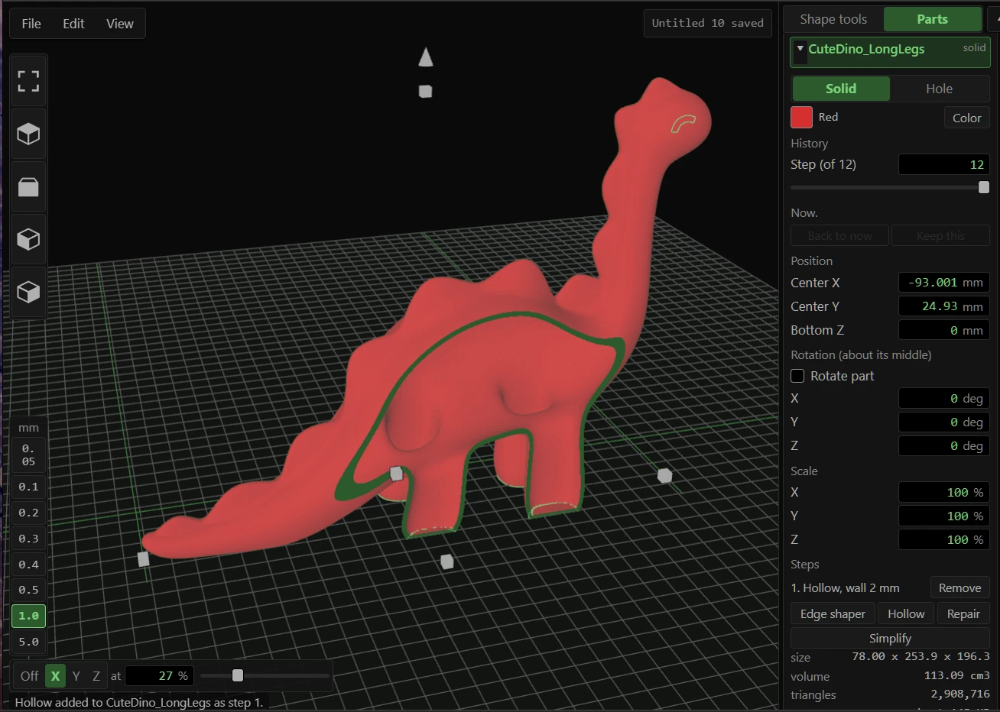

# Workingtitle3D
n

A 3D modeller in one HTML file. It runs in your browser with the network unplugged. No
account, no login, no upload, no telemetry. Your models never leave the machine.

It is new and it will have flaws. It is still better than most free modellers, and it does
not hold your work hostage behind a sign-in.

There are no automatic or in-app updates, and there never will be. New tools and fixes
arrive as new versions here, so check back now and then. Tools get added as they are
needed, so the list below keeps growing.

## Features

- Shapes, holes, groups and intersects, joined with exact mesh booleans
  (https://github.com/elalish/manifold).
- New shapes follow the pointer and sit flat on whatever face they land on. Parts stay on a
  0.05 mm lattice, so parts that meet really meet.
- Every part keeps its recipe. Change a hole after grouping it and the group rebuilds.
- Roll back one part and leave the rest alone.
- Imports STL, 3MF and OBJ, repaired on the way in. A mesh that still is not closed loads
  anyway and works: it moves, groups and exports as it is, and Show faults marks where it
  is open.
- Repair: weld gaps, fill holes, or rebuild the mesh as one solid on a grid you choose.
- Simplify: fewer triangles and a smaller file, held within a distance you set of the
  original surface (0.01 mm by default). The panel shows the STL size before you commit.
- Edge shaper (fillet, chamfer, cove on flat parts) and Hollow, optionally opened through a
  face.
- Save file writes the whole project as one .wt3d file. Parts stay editable, imported meshes
  stay exact, so nothing degrades on a round trip the way it does through STL.
- Color schemes and tooltips in the View menu. Nothing in the interface is told apart by hue
  alone. See ACCESSIBILITY.md.

## Run

Download Workingtitle3D.html from Releases and open it in a Chromium-based browser (Edge,
Vivaldi, Chromium, Brave). That is the whole install. Firefox is not supported.

Brave keeps folder access switched off. Turn on brave://flags/#file-system-access-api to have
projects saved to a folder as you work, or use Save file, which works either way.

To build it yourself:

    npm install
    npm run build

## Keys

| Key | Action |
|---|---|
| Right drag / middle drag / wheel | orbit / pan / zoom to the pointer |
| Ctrl + left drag | orbit |
| Left drag on a part / empty space | move on the plate / select box |
| Shift + click | add to selection |
| Arrows, Ctrl + Up/Down | nudge 1 mm (Shift: 10 mm) following the view, raise / lower |
| Alt + drag | drag a copy |
| Hold R | rotate rings |
| Shift + F, click a face | slide the selected part along that face with the arrows |
| F | fit the selection |
| H / S | hole / solid |
| D | drop to the plate |
| M | mirror X (Shift: Y, Alt: Z) |
| Ctrl + G / Ctrl + Shift + G / Ctrl + I | group / ungroup / intersect |
| Ctrl + D | duplicate (repeats the last offset) |
| Ctrl + C / X / V | copy / cut / paste |
| Ctrl + H / Ctrl + Shift + H | hide / show hidden |
| Ctrl + L | lock |
| Ctrl + Z / Ctrl + Y | undo / redo |
| Ctrl + E | export |
| Delete, Esc | delete, clear selection |

## Tests

    node tests/kernel.mjs         shapes, groups, tool steps, joined export
    node tests/doc.mjs            history, rollback, project folder, crash recovery
    node tests/tools_repair.mjs   repair, make solid, open meshes in groups and cuts
    node tests/simplify.mjs       simplify stays within its surface limit
    node tests/walk.mjs           every function of the built page, headless
    node tests/browser.mjs        the built page, headless

The two browser tests need PUPPETEER_DIR and CHROME_DIR set.

## Licence

Source-available: Apache License 2.0 with the Commons Clause. Use it for anything,
commercial work included. The models you make are yours to sell. Fork it with credit under
the same terms. Do not sell it or a fork of it. Full terms in LICENSE.

Bundled libraries keep their own licences (MIT, Apache-2.0, ISC, Boost 1.0), listed in
THIRD-PARTY-NOTICES.txt and carried inside the built HTML file.

## Acknowledgements

Written with Claude (Anthropic) and Grok (xAI).

## Cyberdeck Cafe

Built at the Cyberdeck Cafe. Neon City Mix and the rest of the crew:
https://cyberdeck.cafe/
